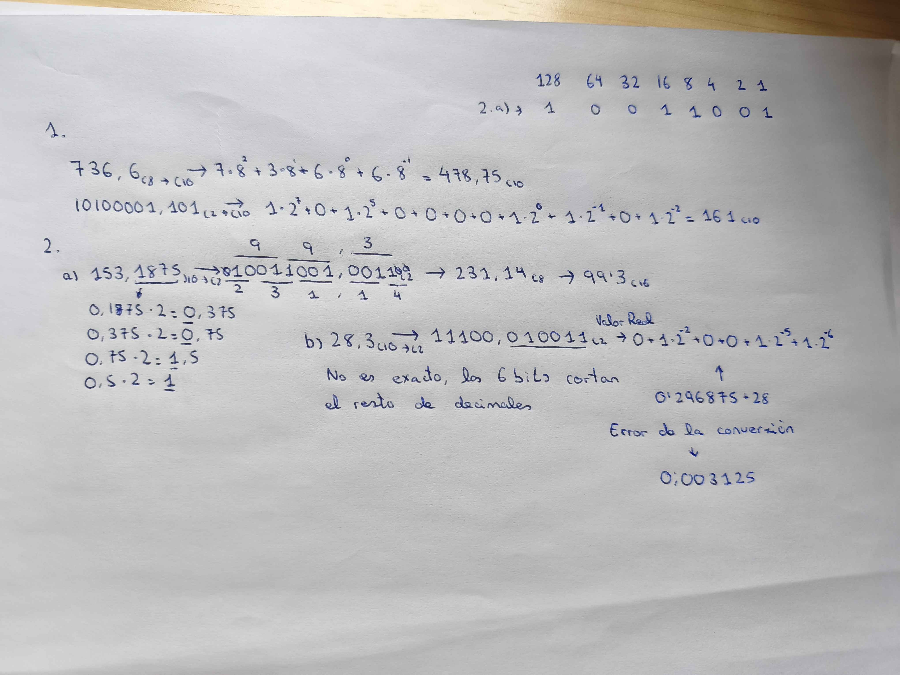
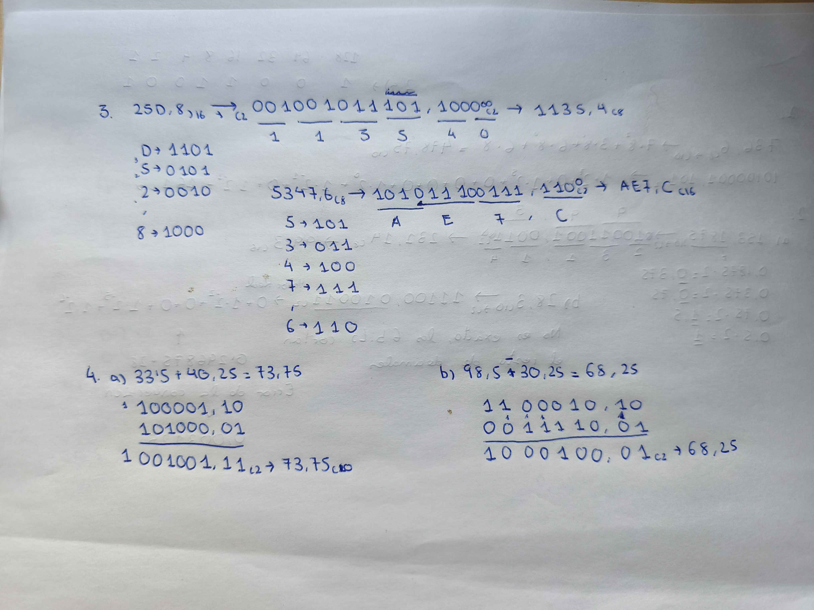
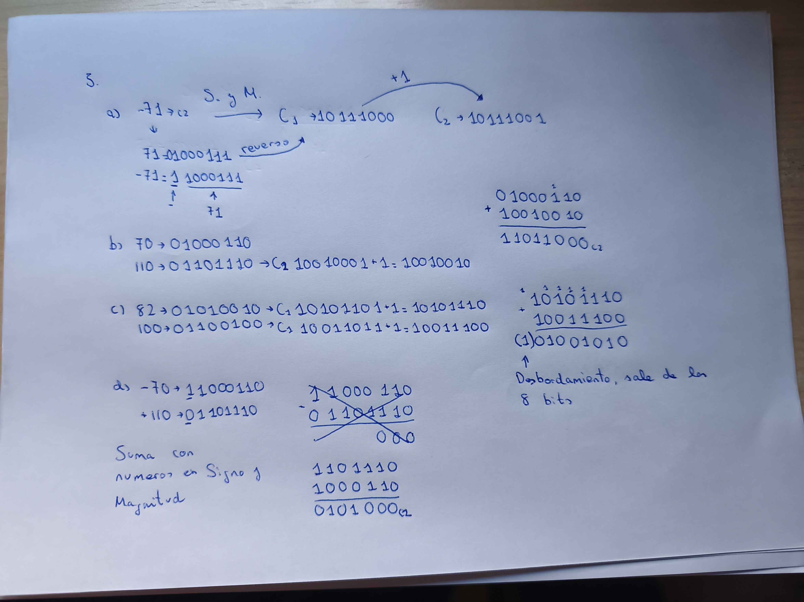
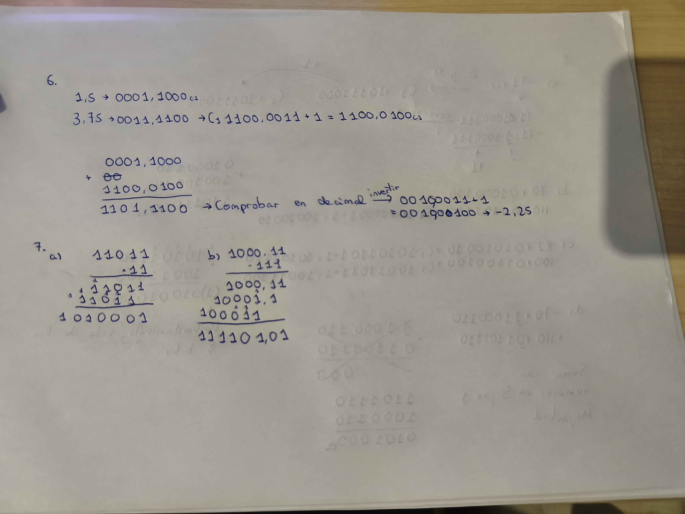
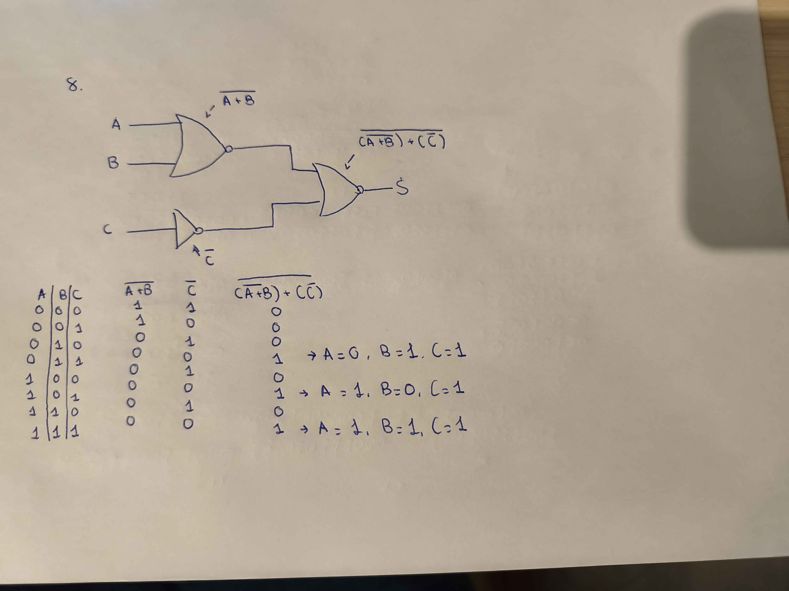

# Relacion de Ejercicios Binarios y las puertas lógicas

> @autor: Sergio AM

## Ejercicio 2

### Apartado1 Teorema Fundamental de la Numeracion
- 736,6)5 -> 478,75)10
- 10100001,101)2 -> 161)10

### Apartado2 Decimal a binario
- 153,1875)10 -> 10011001,0011)2 -> 231,14)8 -> 99,3)16
- 28,3)10 -> 11100,010011)2 -> Error de 0,003125 por conversion de 6 bits

### Apartado3 Octal y hexadecimal
- 25D,8)16 -> 001001011101,1000)2 -> 1135,4)8
- 5347,6)8 -> 101011100111,110)2 -> AE7,C)16

## Apartado4 Aritmetica binaria

 100001,10 +	1100010,10-
 101000,01	0011110,01
 -------------------------
1001001,11)2	1000100,01)2
 73,75)10	 68,25)10

## Apartado5 Numeros con signos de 8 bits

- -71)10 -> (1)1000111 ->(C1)>(1)0111000 ->(C2)>10111001
- 01000110 (70) - 01101110 (110) = 11011000)2
- 10101110 (-82) + 10011100 (-100) = (1)01001010 (el 1 esdesbordamiento)
- 11000110 (-70) + 01101110 (+110) = 010100)2

## Apartado6 Coma fija 8bits

- 0001,1000 (1,5) + 1100,0100 (-3,75) = 1101,1100 (-2,25)

## Apartado7 Multiplicacion y desplazamiento

- 11011*11 = 1010001
- 1000,11 * 111 = 111101,01

## Apartado9 Analisis de un circuito

- (dibujo de la imagen)
- Salida -((-A+B-)+(-C-))- -> 00010101

### Fecha: 15-October-2026
